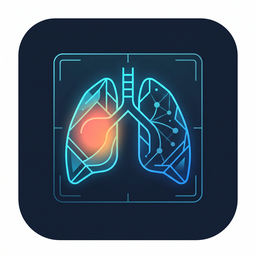

# 🦀 BMI CXR-AI v2 - Rust Native Desktop (Windows) & Mobile (Android) Client

<p align="center">
  
</p>

<p align="center">
  <b>Flutter `cxr_medic` ilovasining 100% sof Rust tilidagi yuqori unumdorlikka ega ekvivalenti</b><br>
  <i>High-performance pure Rust clone of the CXR Medic Clinical Decision Support System</i>
</p>

<p align="center">
  
  
  
  
  
</p>

---

## 🌟 Asosiy Xususiyatlar va Afzalliklar

- **Nol Chiqindi Yig'uvchi (Zero Garbage Collection)**: Dart/Flutter virtual mashinasidan xoli, to'liq xavfsiz va tizimli xotira boshqaruvi.
- **Tezkor Boshlanish va Kam Xotira Iste'moli**: O'rnatilgan xotira xaritalash, bir necha megabayt operativ xotirada ishlaydi.
- **DICOM Dark Workstation Mavzusi**: `#090E17` chuqur ishchi stoli, klinik feruza `#00E5FF` va xavf darajalari bo'yicha dinamik ranglar.
- **Ikki Qatlamli Interaktiv Rentgen Viewport**:
  - Asosiy rentgen tasviri ustiga Grad-CAM++ issiqlik xaritasini real vaqtda shaffoflik slayderi (0% dan 100% gacha) bilan qoplash.
  - Sensor va sichqoncha bilan silliq Pan & Zoom (0.5x dan 5.0x gacha) va holatni tiklash.
  - O'pka fokusi ko'rsatkichi (`91.4%`).
- **14 Ta Kalibratsiyalangan Patologiya**:
  - DenseNet-121 modelining rasmiy test chegaralari asosida qurilgan.
  - Har bir kartada aniq **oq vertikal chegara chizig'i (threshold tick)**.
  - Istalgan patologiya kartasini bosish orqali aynan o'sha kasallikka tegishli Grad-CAM++ issiqlik xaritasiga bir zumda o'tish.
- **Moslashuvchan (Responsive) Dizayn**:
  - Katta ekranlarda (>= 1050px) 3 ustunli keng klinika stoli.
  - Mobil/Android ekranlarda 3 bo'limli qulay pastki navigatsiya paneli (👤 Bemor | 🩻 Rentgen | 📊 Patologiyalar).
- **Oflayn Zaxira Rejimi (Offline Demo Mode)**:
  - Tarmoq yoki server bo'lmaganda ham mustaqil tahlil simulyatsiyasi va vizual issiqlik xaritalari.

---

## 📁 Loyiha Strukturasi

```text
cxr_medic_rust/
├── assets/
│   ├── demo/              # Namuna rentgen va patologiyalar issiqlik xaritalari (PNG)
│   └── icons/             # Ilova logotipi va piktogrammasi (app_icon.png, icon.jpeg)
├── android/               # Android platformasi uchun konfiguratsiya
│   ├── app/src/main/
│   │   └── AndroidManifest.xml   # Permissions, NativeActivity / GameActivity
│   ├── build.gradle.kts
│   └── settings.gradle.kts
├── src/
│   ├── main.rs            # Windows Desktop dasturining kirish nuqtasi
│   ├── lib.rs             # Umumiy kutubxona va Android entrypoint (`android_main`)
│   ├── constants.rs       # 14 patologiya lug'ati, tibbiy ranglar, CDSS matnlari
│   ├── models.rs          # JSON modellar (PredictionRequest, PredictionResponse)
│   ├── services.rs        # HTTP mijozi (`ureq`), oflayn tahlil simulyatori, base64
│   └── app.rs             # Asosiy eframe/egui UI komponentlari, viewport, kartalar
├── .gitignore             # target/ va vaqtinchalik fayllarni inkor qilish
├── Cargo.toml             # Bog'liqliklar va Android APK metadata
└── README.md              # Ushbu qo'llanma
```

---

## 🚀 Kompilyatsiya va Ishga Tushirish

### 1. Windows platformasida

Windows uchun dasturni ishga tushirish yoki binar fayl yig'ish:

```powershell
# Ishga tushirish (Debug)
cargo run

# Yuqori unumdorlikdagi Release talqinini yig'ish
cargo run --release
```

Yig'ilgan mustaqil `.exe` fayli quyidagi manzilda bo'ladi:
```text
cxr_medic_rust/target/release/cxr_medic_rust.exe
```

> **Eslatma**: Windows sarlavhasida (Titlebar) va vazifalar panelida (Taskbar) siz taqdim etgan rasmiy logotip (`icon.jpeg`) aks etadi.

---

### 2. Android platformasida APK yaratish

Rust'da to'g'ridan-to'g'ri APK faylini yig'ish uchun rasmiy `cargo-apk` vositasidan foydalaniladi:

#### Qadam 1: Kerakli vositalarni o'rnatish
```powershell
cargo install cargo-apk
rustup target add aarch64-linux-android armv7-linux-androideabi x86_64-linux-android
```

#### Qadam 2: APK faylini yig'ish
```powershell
cd cxr_medic_rust
cargo apk build --release
```

Yaratilgan APK fayl:
```text
target/release/apk/BmiCxrMedic.apk
```

Qurilmaga o'rnatish:
```powershell
adb install target/release/apk/BmiCxrMedic.apk
```

#### Muqobil: `cargo-ndk` orqali Android Studio'ga yig'ish
```powershell
cargo ndk -t arm64-v8a -t armeabi-v7a -o ./android/app/src/main/jniLibs build --release
```

---

## 🛠 Texnologiyalar To'plami (Tech Stack)

- **UI Framework**: `eframe` va `egui` (Immediate-mode, yengil, GPU tezlanishli).
- **Rendering**: `glow` (OpenGL / GLES).
- **Image Processing**: `image` (PNG, JPEG, CLAHE dekodlash).
- **Tarmoq Mijozi**: `ureq` (Yengil va xavfsiz HTTP mijozi).
- **Serializatsiya**: `serde`, `serde_json`.
- **Fayl Tanlash**: `rfd` (Rust File Dialogs).
- **Android Glue**: `android-activity` (GameActivity).

---

## 📜 Tibbiy Mas'uliyatdan Ozod Bo'lish (CDSS)

Ushbu dasturiy ta'minot faqat ilmiy-tadqiqot, ta'lim va klinik qaror qabul qilishga ko'maklashish (CDSS / Second-Opinion) uchun mo'ljallangan. Mustaqil tashxis qo'yish maqsadlarida foydalanilmaydi.
